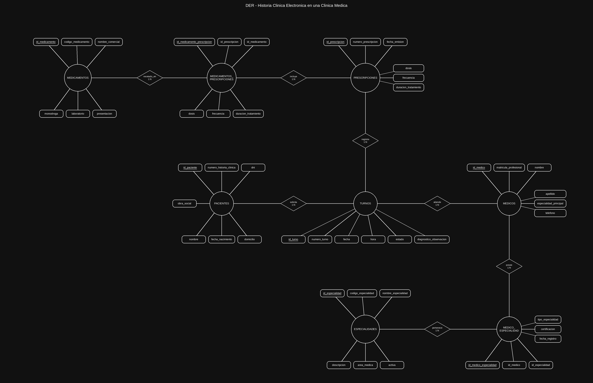
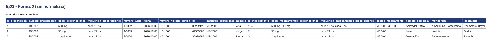
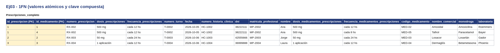
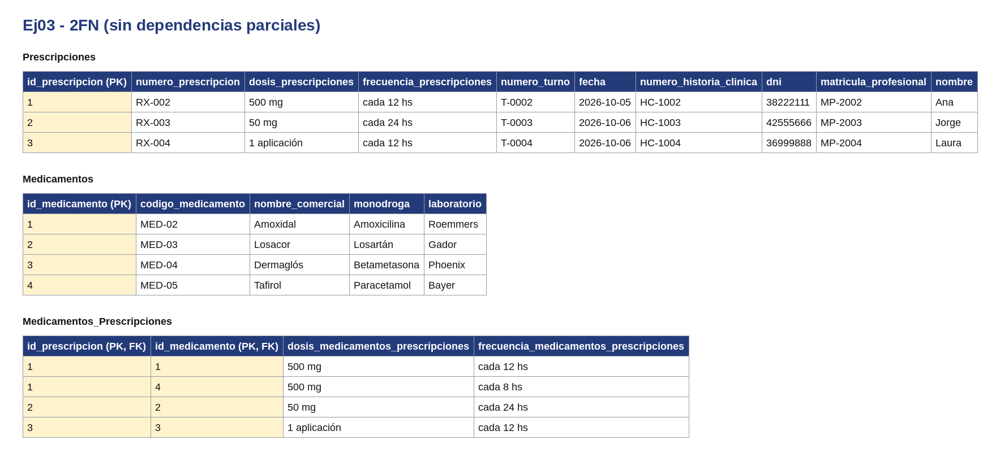
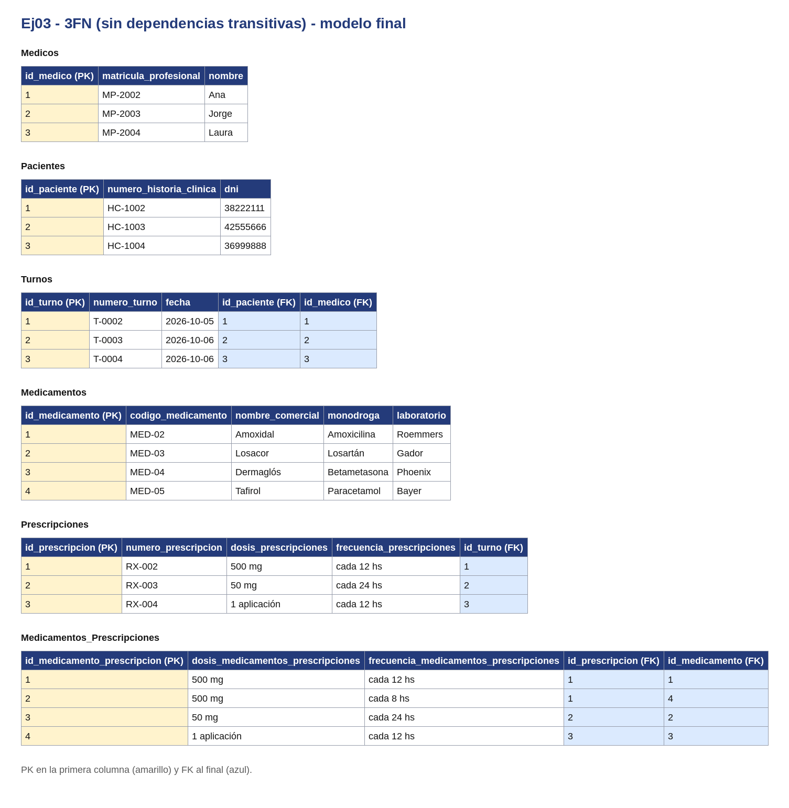

# Sistema de Gestión de Historia Clínica Electrónica

Base de Datos - Unidad 2 - Ejercicio 3

## Consigna
Diseñar el esquema conceptual de base de datos para una clínica privada que centralice la información médica de sus pacientes mediante una historia clínica electrónica unificada, optimizando la asignación de turnos y evitando la pérdida de diagnósticos.

## Lógica

### Entidades Principales:
- **PACIENTES**: Identificados por número de historia clínica, almacenan DNI, nombre, apellido, fecha de nacimiento, domicilio y obra social.
- **MEDICOS**: Identificados por matrícula profesional, registran nombre, teléfono y especialidad principal.
- **ESPECIALIDADES**: Catálogo de especialidades médicas (Cardiología, Pediatría, etc.) identificadas por código.
- **TURNOS**: Registran cada consulta médica con fecha, hora, estado (Programado, Atendido, Cancelado) y diagnóstico/observación.
- **MEDICAMENTOS**: Catálogo de medicamentos identificados por código alfanumérico, con nombre comercial, monodroga y laboratorio.
- **PRESCRIPCIONES**: Entidad intermedia M:N que registra la receta de medicamentos en cada turno, incluyendo dosis, frecuencia y duración del tratamiento.

### Relaciones:
- **SOLICITA (1:N)**: Un paciente solicita múltiples turnos; cada turno pertenece a un único paciente.
- **ATIENDE (1:N)**: Un médico atiende múltiples turnos; cada turno es atendido por un único médico.
- **POSEE (M:N)**: Un médico posee múltiples especialidades (principal y secundarias); una especialidad puede pertenecer a varios médicos.
- **REGISTRA_EN (1:N)**: Un turno genera múltiples prescripciones; cada prescripción pertenece a un único turno.
- **RECEPTA (M:N)**: Un medicamento puede ser recetado en múltiples prescripciones; una prescripción puede incluir múltiples medicamentos.

### Decisiones de Diseño:
- Se creó la entidad **PRESCRIPCIONES** como tabla intermedia M:N para registrar los atributos específicos de cada medicamento recetado (dosis, frecuencia, duración), permitiendo que un mismo medicamento se prescriba en diferentes consultas.
- La relación **POSEE** entre Médicos y Especialidades es M:N para permitir que un médico tenga especialidades secundarias además de la principal.
- **TURNOS** almacena diagnóstico/observación porque cada turno genera un único registro de atención, evitando duplicación de datos.
- Se utilizó **número_historia_clinica** como identificador de pacientes en lugar de DNI para mantener compatibilidad con sistemas clínicos estándar.

## Resultado

Atributos agregados para llegar al id más 5: `telefono` (Médicos), `area_medica` y `activa` (Especialidades), `fecha_emision` (Prescripciones) y `presentacion` (Medicamentos). Se sacó `codigo_medicamento` de Médicos porque ese vínculo ya sale de Turnos → Prescripciones → Medicamentos.

---

## Normalización

Se normaliza el documento `Prescripciones` con sus registros de `Medicamentos_Prescripciones`. En todas las tablas la PK va en la primera columna y las FK al final. Los datos son de ejemplo.

**Forma 0.** Una sola tabla con todo junto. Hay celdas con listas: cada prescripciones puede tener varios registros de medicamentos prescripciones.

**1FN.** Cada elemento de la lista pasa a su propia fila y la clave queda compuesta: (`id_prescripcion`, `id_medicamento`).

**2FN.** Los datos de prescripciones dependen solo de `id_prescripcion` y los de medicamentos solo de `id_medicamento`. Se separan en `Prescripciones` y `Medicamentos`; `Medicamentos_Prescripciones` queda con la clave compuesta y lo que depende de ambos.

**3FN.** Los datos de `Turnos`, `Pacientes` y `Medicos` dependen de su propio identificador y no de la PK de prescripciones, así que pasan a tablas aparte. En el modelo final cada tabla usa su id propio.

